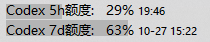
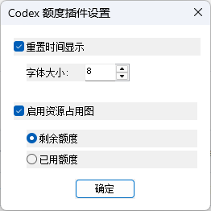

# TrafficMonitor Codex Simple 插件

一个用于 Windows **TrafficMonitor** 的原生 x64 插件，专注于 **Codex 额度和截止（重置）时间** 的简单显示：任务栏显示 5 小时 / 7 天额度百分比，可追加截止时间并单独调整时间字号。资源占用图用于可视化同一份额度数据。

这是社区插件，与 OpenAI、TrafficMonitor 官方无隶属关系。当前版本为 **V0.1.3**。

## 版本与开发说明

| 版本 | 开发归属 | 功能与工作 |
| --- | --- | --- |
| V0.1.0 | **deepseek flash V4.1 独立完成** | 第一版，仅提供额度显示功能 |
| V0.1.1 | **deepseek flash V4.1 独立完成** | 在额度显示基础上，添加资源占用图的控制功能 |
| V0.1.2 | **Codex 独立完成** | 添加额度截止时间的显示和控制功能，包括显示开关与时间字号调整；完成后续整理、技术文档、截图及 GitHub 上传 |
| V0.1.3（当前） | **Codex 独立完成** | 补齐 TrafficMonitor 1.85.1 的初始化兼容，修复开启时间后宿主自定义文本失效；兼容标签引号与保留空格 |

V0.1.2 在前两个版本的代码基础上继续迭代。以上版本及开发归属按项目维护者提供的历史记录说明。

## 实际效果

### 任务栏显示



前面的显示文本和额度百分比保留原有样式，重置时间追加在 `%` 后。5 小时窗口使用 `HH:mm`，7 天窗口使用 `MM-dd HH:mm`，均为本机时区。图中的额度和时间是截图时的实际读数，不代表当前账号状态。

### 插件设置



时间显示与字号设置位于资源占用图设置之前。字号可直接输入正整数，也可通过右侧上下箭头调整；它只影响时间文字。设置窗口在当前显示器工作区居中打开。

**“剩余额度 / 已用额度”单选项只控制资源占用图，不会切换任务栏文字百分比。** 设置窗口没有“将额度文字改为已用百分比”的功能。

## 显示项目

| TrafficMonitor 中的项目名称 | 默认显示文本 | 内容 |
| --- | --- | --- |
| `Codex 5小时额度` | `Codex 5h额度:` | 300 分钟窗口的额度百分比，可追加重置时间 |
| `Codex 7天额度` | `Codex 7d额度:` | 10080 分钟窗口的额度百分比，可追加重置日期及时间 |

- 任务栏文字默认显示**剩余百分比**，即 `100 - usedPercent`。
- 鼠标悬停可查看已用/剩余比例、重置时间、套餐、数据来源和数据时间。
- 资源占用图可选择展示已用或剩余额度，切换只影响图形。
- `--` 表示该窗口尚无可用数据。历史数据在悬停说明中标注，百分比后不添加 `*` 等状态符号。

## 环境要求与安装

需要 64 位 Windows、**64 位 TrafficMonitor**，以及本机可运行的官方原生 `codex.exe`。请先在 Codex 中使用需要查询额度的 ChatGPT 账号登录。V0.1.3 同时处理 1.85.1 的 `EI_CONFIG_DIR` 初始化和新版 API 7 的 `OnInitialize`，无需为此升级宿主。新旧加载流程已通过模拟回归测试；本机 1.8.6.0 的加载、真实额度数据、时间绘制回调和已保存文本同步已通过运行状态检查，1.8.5.1 实机仍待验证。

**推荐直接下载 [CodexUsage.dll](https://github.com/WangSiZeng/TrafficMonitor-Codex-Simple/releases/latest/download/CodexUsage.dll)**，无需下载源码或完整 ZIP。

如需离线说明、截图、示例配置及许可文件，可选择 [Release 中的完整 ZIP](https://github.com/WangSiZeng/TrafficMonitor-Codex-Simple/releases/latest)。单 DLL 与同版 ZIP 内的 DLL 完全一致。

1. 退出 TrafficMonitor。
2. 将下载得到的 `CodexUsage.dll` 复制到 TrafficMonitor 的 `plugins` 目录。
3. 重新启动 TrafficMonitor，在“其他功能 → 插件管理”确认“Codex 额度”已加载。
4. 在任务栏的显示设置中勾选 `Codex 5小时额度` 和 `Codex 7天额度`。
5. 在额度显示区域右键，通过“Codex 额度 → 选项”设置时间显示、时间字号及资源占用图。

便携安装的常见目录结构：

```text
TrafficMonitor/
├─ TrafficMonitor.exe
└─ plugins/
   ├─ CodexUsage.dll
   └─ CodexUsage.ini       # 可选配置，不包含登录令牌
```

实际配置目录由 TrafficMonitor 提供，非便携模式下可能与 DLL 目录不同。手动配置时，将仓库中的 `CodexUsage.example.ini` 复制到该配置目录并重命名为 `CodexUsage.ini`。

首次安装仅需放置 DLL，不必预先创建 INI。插件已静态链接 C/C++ 运行库和 JSON 解析器，不需要随附其他插件运行库 DLL。Release 中的 `.sha256` 文件用于可选的完整性核验；`CodexUsage-LICENSE.txt` 提供许可及第三方声明，不是运行依赖。再分发时请保留适用的许可声明。

升级时退出 TrafficMonitor 后替换 DLL，保留已有配置即可。x86 TrafficMonitor 不能加载本项目的 x64 DLL。

## 数据来源与查询流程

本插件通过**本机 Codex app-server 的 JSON-RPC 标准输入/输出协议**查询额度，流程如下：

```text
TrafficMonitor
  └─ CodexUsage.dll 后台线程
      └─ 启动本机 codex.exe app-server
          ├─ initialize → 等待匹配的初始化响应
          ├─ initialized
          └─ account/rateLimits/read → 读取当前额度
```

每轮查询启动一个隐藏的子进程，读取结果后关闭输入管道并回收进程。本插件只发送初始化和额度读取请求，不创建会话、发送提示词、启动模型任务或兑换重置额度。

### 额度解析

| 返回字段 | 本插件的处理 |
| --- | --- |
| `rateLimitsByLimitId.codex` | 优先选择 Codex 对应的限额桶 |
| `rateLimits` | 未提供 Codex 多桶结果时，兼容单桶返回；拒绝明确属于其他产品的限额 |
| `windowDurationMins` / `window_minutes` | 按实际时长归类：300 分钟为 5 小时，10080 分钟为 7 天 |
| `usedPercent` / `used_percent` | 校验 0～100 的有限数值，文字默认转换为剩余百分比；资源占用图按自己的设置选择已用或剩余 |
| `resetsAt` / `resets_at` | 校验 Unix 时间戳，按本机时区格式化 |
| 空缺或 `null` 窗口 | 两个窗口独立处理，缺失的一项显示 `--` |

不假定 `primary` 必须是 5 小时、`secondary` 必须是 7 天，也不会将其他时长的限额误标为这两个窗口。

### Codex 程序与登录状态

未设置 `codex_path` 时，插件会检查当前用户的 Codex 桌面安装目录、注册的 Codex 应用包路径，以及 `PATH` 中的绝对目录。找不到程序时，可在 INI 中填写可信原生 `codex.exe` 的绝对路径。

只支持 `.exe`，不将 `.cmd` / `.bat` 启动脚本当作 Codex，也不从当前工作目录搜索程序。通过 npm 安装后若只能找到 `codex.cmd`，需要定位该安装中的原生 `codex.exe`。

认证、令牌存储、刷新以及向服务端发出请求，均由所启动的 Codex 负责。子进程继承 TrafficMonitor 的环境，包括 `CODEX_HOME`；请确保它与平时使用的 Codex 指向同一个账号和登录存储。切换账号后应重启 TrafficMonitor。

本插件不直接读取 `auth.json`、提取令牌，也不自行请求 `chatgpt.com/backend-api/wham/usage`。API key 的计费额度不属于本插件支持的 ChatGPT 订阅额度。

官方协议参考：[Codex app-server](https://learn.chatgpt.com/docs/app-server)。

## 刷新与失败处理

- 启动插件时立即发起一次后台查询。之后由 TrafficMonitor 的数据回调按 `refresh_seconds` 触发，默认 **300 秒**；实际触发时间受宿主回调调度影响。
- `refresh_seconds=120` 有效，表示约每两分钟刷新一次。支持范围为 **30～86400 秒**；超出范围会限制到边界，无法解析的值回到默认值。
- 同一时刻只运行一轮查询，不会在绘图函数里等待网络请求。协议响应等待上限为 20 秒，进程清理另有短暂等待。
- 短暂失败时保留内存中的最近一次有效结果，在悬停说明中标为“历史数据”，保留原数据时间。恢复查询后更新为新结果。
- 尚未获得有效结果时显示 `--`。仅因重置时间到达，不会自行推算额度已恢复为 100%。
- 插件不将额度缓存写入磁盘，重启后重新获取。自动探测到的 Codex 桌面安装路径失效时，会重新探测；发现新路径后再尝试查询。

### 可选的本地会话回退

默认 `allow_local_fallback=0`，不读取本地会话。主动开启后，查询失败会尝试解析会话文件尾部的 `event_msg/token_count.rate_limits`；**仅在内存中没有任何有效额度时采用该快照**。

这仍是历史快照，可能属于更早的会话或账号，不保证实时性。插件保留事件原时间，并在悬停说明中标为“历史数据”。需要准确当前额度时，应优先解决 app-server 查询问题。

## 配置

以下示例每 120 秒刷新一次，开启时间显示并将时间字号设为 8 磅：

```ini
[config]
refresh_seconds=120
show_remaining=1
show_reset_time=1
time_font_size=8
graph_enabled=1
graph_mode=remaining
allow_local_fallback=0
; 可选：可信原生程序的绝对路径
; codex_path=C:\Tools\Codex\codex.exe
; 可选：仅用于已开启的本地回退
; sessions_dir=C:\Data\Codex\sessions
```

| 配置项 | 默认值 | 说明 |
| --- | --- | --- |
| `refresh_seconds` | `300` | 后台查询间隔，单位秒，范围 30～86400 |
| `show_remaining` | `1` | 文字显示的兼容 INI 项，常规使用保留 `1`（剩余）；设置窗口不提供文字模式切换 |
| `show_reset_time` | `0` | 是否在百分比后追加重置时间，可在插件设置中勾选 |
| `time_font_size` | `10` | 时间字号，单位磅，支持正整数，无 6～16 的固定限制 |
| `graph_enabled` | `0` | 是否启用资源占用图；实际绘图还取决于宿主设置 |
| `graph_mode` | `remaining` | **只控制资源占用图**：`remaining` 为剩余，`used` 为已用；不会切换额度文字 |
| `allow_local_fallback` | `0` | 是否允许读取本地会话历史快照 |
| `codex_path` | 自动探测 | 可信原生 `codex.exe` 的绝对路径 |
| `sessions_dir` | 自动选择 | 本地回退目录；未设置时使用 `CODEX_HOME\sessions`，否则为用户的 `.codex\sessions` |

INI 在插件启动时读取；手动修改后需要重启 TrafficMonitor。插件设置窗口中的修改在点击“确定”后生效并保存；点击取消或关闭窗口不保存。

设置窗口中的“剩余额度 / 已用额度”写入的是 `graph_mode`，不会修改文字显示的 `show_remaining`。

V0.1.3 的资源占用图仍由 TrafficMonitor 绘制，需要同时开启宿主的图形总开关和插件的图形开关。插件自行绘图属于后续版本的功能，本版不包含该改动。

### 默认文本与宿主自定义文本

默认文本为 `Codex 5h额度:` / `Codex 7d额度:`。TrafficMonitor 已保存的自定义文本优先，包括主动清空的文本，不会被插件强制覆盖。若升级后仍显示旧的 `5h` / `7d`，可在 TrafficMonitor“选项 → 显示设置 → 显示文本设置”中改为上述完整标签。

关闭时间显示时，由宿主正常绘制标签和百分比。开启时间显示时，为了单独指定时间字号，插件接管该项绘制，并沿用宿主字体、颜色、数值对齐及已保存的标签；主窗口与任务栏标签分别处理。修改宿主显示文本后点击“应用”或“确定”，标签和测量宽度会自动同步，无需重启。

标签同步只读宿主配置，检查间隔为 250 毫秒，文件未变化时不重复解析；它与 120/300 秒的额度查询间隔无关。插件只保存自己的设置，不修改宿主的显示文本。

配置目录直接采用宿主传入的路径，不依赖某台电脑的安装位置。`plugins/CodexUsage.ini` 保存插件自己的时间与图形设置；宿主的显示文本位于上一级 `config.ini` 的 `[plugin_display_str_taskbar_window]` / `[plugin_display_str_main_window]`。非便携模式使用宿主提供的用户配置目录，同样按此相对关系读取。标签按宿主的字符串规则解码，保留引号内的空格和主动清空的内容。

## 代理与网络

本插件不单独实现 HTTP / SOCKS5 代理，也不支持 `[Network] Proxy` 或 `CODEX_USAGE_PROXY`。这些是其他插件的配置，复制到本项目的 INI 不会生效。

额度请求由 `codex.exe` 发出；具体代理行为由所用 Codex 版本、其配置及继承的进程环境决定，不能将本插件视为“强制使用 Windows 系统代理”或“内置 SOCKS5”。请先确认同一账号、同一环境中的 Codex 能正常访问服务。改变外部环境变量后，需要重新启动 TrafficMonitor，让新的子进程继承设置。

## 安全与隐私

- 使用有大小限制的结构化 JSON 解析，并严格匹配 JSON-RPC 响应 ID，避免把无关通知或会话内容当作当前结果。
- 子进程仅继承需要的标准输入、标准输出和丢弃诊断的句柄，不继承宿主其他可继承句柄。
- 后台查询期间持有 DLL 引用，查询结束后再释放，避免宿主卸载插件时仍执行已卸载的代码。
- 插件不输出原始响应、令牌或 Codex 的标准错误内容，不提供遥测、远程控制端口或监听服务。
- Codex 自身仍可能更新登录缓存、数据库或日志；“插件不保存凭据”不代表 Codex 和系统没有自身状态文件。
- 开启本地回退后，读入的会话尾部可能包含正文，虽然插件只提取额度事件。请勿分享真实会话文件、`auth.json` 或自己的配置文件。
- 指定的 `codex.exe` 会以 TrafficMonitor 的权限运行，应使用可信程序和配置；不需要硬件温度监控时，可按宿主说明选择适合的运行权限。

更多说明见 [SECURITY.md](SECURITY.md)。

## 构建、测试与打包

需要 Visual Studio 2022 或 Build Tools，并安装“使用 C++ 的桌面开发”工作负载。脚本通过 `vswhere` 定位工具链：

```bat
build.bat
test_build.bat
test_options.bat
```

- `build.bat`：生成 `build\CodexUsage.dll`，使用静态 C/C++ 运行库。
- `test_build.bat`：运行合成额度、配置、句柄隔离、DLL 生命周期和绘制回归测试，不读取真实登录或会话。
- `test_options.bat`：打开测试程序自己的设置窗口，验证确认/取消、布局及字号输入。

可选的真实账号只读测试：

```bat
build\backend_tests.exe --live "C:\Tools\Codex\codex.exe"
```

该模式使用所指定 Codex 的真实登录和网络，仅打印查询状态及额度百分比，不打印令牌、账号标识或响应正文。

打包与发布文件检查：

```powershell
.\scripts\check-release.ps1
.\scripts\package.ps1
# 仅生成独立 DLL、校验文件和许可声明，不重新生成 ZIP：
.\scripts\package.ps1 -DllOnly
```

隐私检查针对 Git 暂存区的发布文件及已构建 DLL；执行前应先暂存计划发布的修改。打包同时输出独立 DLL、配套校验与许可文件，以及包含 DLL、示例配置、README、截图和许可文件的 ZIP；不包含真实配置或凭据。DLL 未进行代码签名。

GitHub Actions 配置仅作为 `ci/build.yml.example` 保存，不会自动执行。需要启用时，将其放入 `.github/workflows/build.yml`，并使用具有相应 workflow 权限的凭据提交。

### 主要文件

| 文件 | 职责 |
| --- | --- |
| `CodexUsage.cpp` | 插件接口、后台刷新调度、设置窗口、显示文本同步和时间绘制 |
| `UsageBackend.cpp` / `.h` | Codex 路径解析、子进程协议、额度解析和可选本地快照读取 |
| `PluginInterface.h` | TrafficMonitor API 7 接口定义 |
| `third_party/yyjson/` | JSON 解析器与第三方许可证 |
| `tests/`、`test_options.cpp` | 模拟 app-server、后端与设置窗口测试 |
| `docs/images/` | README 使用的实际截图 |

## 常见问题

| 现象 | 检查方式 |
| --- | --- |
| 插件没有加载 | 确认 DLL 位于 `plugins`，宿主为 x64；替换 DLL 后重启 |
| 1.85.1 开启时间后自定义文本失效 | V0.1.2 漏处理旧版的配置目录通知；使用包含该修复的 V0.1.3 DLL，重启后在宿主修改文本并点击“应用”或“确定” |
| 两项均显示 `--` | 确认 Codex 已用 ChatGPT 账号登录；检查原生程序路径、账号环境和网络 |
| 只有一个窗口显示 `--` | 服务可能未提供该窗口，或实际时长不属于 300/10080 分钟，不能据此假定两项都故障 |
| 百分比不更新 | 查看悬停说明是否为历史数据，核对数据时间；INI 改动后需重启 |
| 仍显示 `5h` / `7d` | 宿主保留了旧文本，在“显示文本设置”中修改；新默认值不会覆盖自定义文本 |
| 设置代理后无效 | 核对是否误用了其他插件的 `[Network]` 配置，本插件的网络由 Codex 负责 |
| Codex 更新后查询失败 | 等待自动重探测，或修正显式 `codex_path`；上游协议变化也可能需要更新插件 |

## 许可与责任限制

本项目采用 [MIT 许可证](LICENSE)，允许商业使用、修改、再分发和销售软件副本；再分发时须保留适用的版权及许可声明。TrafficMonitor 插件接口和 yyjson 的版权声明见 [THIRD_PARTY_NOTICES.md](THIRD_PARTY_NOTICES.md)。本仓库不包含 TrafficMonitor 主程序，其许可不因本插件而改变。

在适用法律允许的最大范围内，软件按“原样”提供，不提供担保；作者及版权持有者不对使用本插件产生的经济损失、数据丢失、业务中断、额外费用或其他损害承担责任。完整条款见 [LICENSE](LICENSE)，中文解释见 [DISCLAIMER.md](DISCLAIMER.md)。

MIT 仅覆盖代码版权授权，不替代 OpenAI 等第三方服务的条款，也不单独授予账号认证的商业或托管服务使用权。有关 app-server 登录集成的适用要求，见 [OpenAI 官方认证说明](https://learn.chatgpt.com/docs/app-server#auth-endpoints)。

README 的组织形式参考 [TrafficMonitor_Codex_Plugin_Proxy](https://github.com/lengmh/TrafficMonitor_Codex_Plugin_Proxy)。本插件的实现以本仓库源码为准；其直接令牌查询及代理配置方式不适用于本项目。
